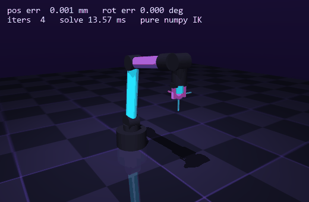
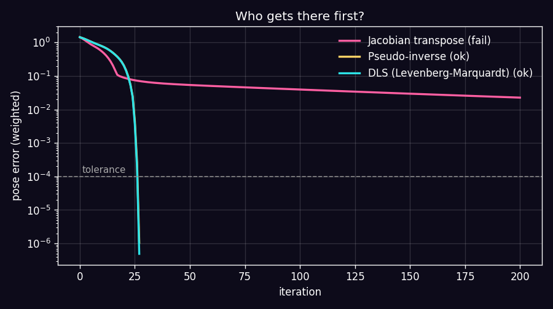

# ARMageddon

> Inverse kinematics for a 6-DoF robot arm, **from scratch**. No ikpy, no off-the-shelf solvers, no "there's a function for that in ROS".
> Just NumPy, linear algebra and a healthy amount of suffering.



*The arm chases a target along a figure-eight, re-solving IK every single frame. Error in the thousandths of a millimeter, ~0.7 ms per solve. Not edited. That's just the Jacobian doing its thing.*

---

## TL;DR

- **Forward kinematics, the Jacobian and 3 IK solvers** in pure NumPy. MuJoCo is only there for physics and the pretty pictures.
- **The math matches MuJoCo to 1e-9** on random configurations. You don't have to take my word for it, the tests check it.
- **99.6% success** on 500 random 6D poses (position + orientation).
- **Real physics**: in interactive mode the arm is moved by motors under gravity. No teleporting.
- **76 tests**, a benchmark and a convergence plot. Everything reproduces with one command.

## What even is this

A robot arm has joints. Rotate the joints and the tip of the arm (the end effector) ends up somewhere.

- **Forward kinematics (FK)**: "here are the joint angles, where's the tip?" Easy. Chain the rotations together and you're done.
- **Inverse kinematics (IK)**: "I want the tip *right here*, rotated *like this*. What angles get me there?" This is where it becomes a skill issue. There's no closed-form answer in general, there can be several solutions, zero, or infinitely many, and on top of that every joint has limits.

Without IK a robot can't grab a mug, press a button or assist a surgeon. It's the foundation of physical AI that everything else sits on: imitation learning, VLA models, and "robot, fetch me a drink" (juice, obviously).

## How it works (the math, no cap)

**1. Forward kinematics.** Walk from the base to the tip, accumulating rotation $R$ and position $p$:

$$p_i = p_{i-1} + R_{i-1}\,o_i, \qquad R_i = R_{i-1}\,\mathrm{Rot}(a_i, q_i)$$

where $o_i$ is the joint offset, $a_i$ its axis, and $\mathrm{Rot}$ is Rodrigues' formula. That's the whole FK.

**2. The Jacobian.** Tells you where the tip moves if you nudge each joint a tiny bit. For a revolute joint with world axis $z_i$ at point $p_i$:

$$J_i = \begin{bmatrix} z_i \times (p_{ee} - p_i) \\ z_i \end{bmatrix}$$

The tests check it against both MuJoCo (`mj_jacSite`) and finite differences. It matches. We checked three times. Okay, 26 times.

**3. Pose error.** Position is just a vector difference. Orientation is trickier: you can't subtract rotation matrices, so we use the SO(3) log map $\log(R_{target} R^\top)$, i.e. "which axis to turn around, and by how much". The hand-rolled version stays stable even near 180-degree rotations, where the naive formula divides by zero.

**4. The solver step.** Solve $J\,\Delta q \approx e$. Three ways to do it, from boomer to zoomer:

| Method | Formula | Vibe |
|---|---|---|
| Jacobian transpose | $\Delta q = \alpha J^\top e$ | Cheap, but crawls like a snail |
| Pseudo-inverse | $\Delta q = J^{+} e$ | Fast, but twitchy near singularities |
| **DLS / Levenberg-Marquardt** | $\Delta q = J^\top (J J^\top + \lambda^2 I)^{-1} e$ | Fast and doesn't freak out. Our pick |

**5. The extras on top of DLS that make it actually good:**

- **Adaptive damping.** If a step reduced the error, lower $\lambda$ and be bolder. If it didn't, roll back and raise $\lambda$. Classic Levenberg-Marquardt.
- **Joint limits via an active set.** When a joint hits its limit, it's frozen for that step and the remaining joints re-solve the task. Plain clipping silently eats the progress and the solver gets stuck. I got stuck on exactly this before fixing it, lol.
- **Stall detection and restarts.** If the error drops by less than 1% over 25 iterations, we're in a local minimum, so start over from a random configuration. The stall detector made the solver about 2.3x faster with zero accuracy loss.
- **Null space.** The arm has 6 joints, and spare degrees of freedom can go toward a secondary goal ("stay close to a comfortable pose") without touching the main one: $(I - J^{+}J)(q_{rest} - q)$.
- **Gravity compensation** in physics mode. The motors get fed the torque gravity would otherwise eat, so the arm stops sagging.

## Benchmark

500 random reachable 6D poses, starting from the home pose, tolerance 0.1 mm / 0.06 deg. Pure Python on a regular laptop, so read the timings as orders of magnitude, not world records.

| Solver | Success | Median iterations | Time per solve |
|---|---|---|---|
| Jacobian transpose | 24.8% | 114 | ~37 ms |
| Pseudo-inverse | 71.4% | 21 | ~12 ms |
| DLS (Levenberg-Marquardt) | 71.6% | 21 | ~26 ms |
| **DLS + 10 restarts** | **99.6%** | 26 | ~50 ms |



**The honest breakdown, no snake oil:**

- On random targets, pinv and DLS are neck and neck, both converge quadratically. About 28% of poses aren't reachable from the home pose: a solution exists, but on a different "branch" (elbow up vs. down, flipped wrist). Restarts fix that, not a better step formula.
- DLS wins where pinv panics: **near singularities**. Test: drag the target past the arm's reach (the arm goes fully straight) and back. Pinv averages **4.33 deg/frame** of joint jitter, DLS averages **1.27 deg/frame**. That's 3.4x smoother, and the final error is 0.002 mm vs. 0.053 mm. On real hardware, that's the difference between "smooth" and "burnt-out motor".
- When tracking a moving target with a warm start, a solve takes ~2 iterations and under 1 ms. Plenty for real-time control.
- Physics: without gravity compensation the arm lags the target by 21.6 mm on average, with it by **5.1 mm**.

## Running it

```bash
pip install -r requirements.txt
```

Interactive, with physics. The target flies around on its own:

```bash
python scripts/play.py --auto
```

Or move the target yourself: double-click the pink sphere, then **Ctrl + right-drag** to move it, **Ctrl + left-drag** to rotate it.

```bash
python scripts/play.py
```

Use it as a library in your own project (that's how the next projects in the series reuse it):

```bash
pip install git+https://github.com/nonberw/armageddon
```

```python
from armageddon import default_arm, forward, solve
from armageddon.mjcf import ARM_MATERIALS, arm_actuators, arm_xml  # same robot, your scene

chain = default_arm()
res = solve(chain, target_pos, target_rot, restarts=10)
xml_bodies = arm_xml(chain, gripper="parallel")  # two slide-jointed fingers for real grasping
```

Tests, benchmark and regenerating the GIF:

```bash
python -m pytest
```

```bash
python scripts/benchmark.py --n 500
```

```bash
python scripts/render_gif.py
```

## What's where

```
armageddon/
  kinematics.py   # SO(3), FK, Jacobian, the arm description
  ik.py           # three solvers, LM, active set, null space, restarts
  mjcf.py         # builds the MuJoCo scene from the same arm description
  trajectory.py   # the figure-eight for the demo
scripts/
  play.py         # interactive mode with physics and gravity compensation
  benchmark.py    # the table + the plot
  render_gif.py   # the GIF at the top
tests/            # 76 tests: FK/Jacobian vs. MuJoCo, convergence, limits
```

The robot model is built **from the same description** as the math (`mjcf.py`). So the simulation and the formulas physically can't drift apart, and the tests confirm it.

## Roadmap

This is the first project in a "physical AI from scratch" series:

- [x] **ARMageddon**: IK, Jacobians, control
- [x] [YOINK](https://github.com/nonberw/yoink): vision-based pick-and-place, built on this library (810/810 cubes sorted)
- [x] [COPYCAT](https://github.com/nonberw/copycat): imitation learning from demonstrations (BC vs action chunking)
- [x] [ZOOMIES](https://github.com/nonberw/zoomies): RL locomotion, a quadruped that walks and takes a kick
- [ ] Sim-to-real on an actual SO-101 arm

## FAQ

**Why write your own when libraries exist?**
To understand what's going on under the hood. When a robot suddenly jerks on real hardware, "well, the library decided so" isn't an answer. "You're near a singularity, crank up the damping" is.

**Why ARMageddon?**
Because arm. Yes, I laughed. Yes, at my own joke.

**Can it control a real arm?**
The solver outputs joint angles, and you can send those to servos. To make that safe you'd also want velocity limits, collision checking and a much bigger STOP button. Those are the next steps.

## License

[MIT](LICENSE)

---

*Made with NumPy and exactly zero calls to `ikpy.solve()`.*
